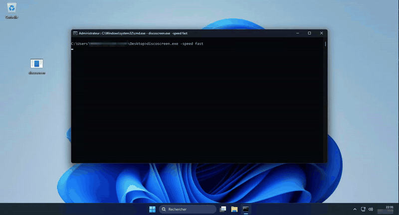

# 🌈 Discoscreen

> Un outil Go pour Windows qui applique un effet de jeu de lumière (discothèque) dynamique à votre écran via l'API Magnification.




*L'effet applique de légères variations de teinte à l'ensemble de l'écran. La compression du GIF atténue le rendu, plus visible en conditions réelles.*

---

## ⚡ Fonctionnalités

- **Jeu de lumière plein écran** : Applique un filtre dynamique et coloré directement sur votre affichage.
- **API Windows Native** : Utilise `Magnification.dll` sans surcouche lourde.
- **Faible consommation de ressources** : Environ 2,3 Mo de mémoire et une faible utilisation du processeur, pour rester adapté aux PC moins puissants.
- **Arrêt rapide** : Appuyez sur `Échap`, ou sur `Ctrl+C` dans le terminal, pour arrêter l'effet.

## 🚀 Utilisation

Téléchargez [Discoscreen.exe](https://github.com/l3nnyz/discoscreen/releases/tag/v1.1.0), puis lancez-le. Par défaut, appuyez sur **Échap** pour arrêter l'effet et fermer le programme. Vous pouvez aussi appuyer sur **Ctrl+C** dans la fenêtre du terminal.

Des options peuvent être passées en lançant le programme depuis un terminal :

```powershell
.\discoscreen.exe -exittime 60
```

`-exittime` définit la durée maximale de l'effet, en secondes. Sa valeur par défaut (`0`) désactive cette limite.

Pour désactiver l'arrêt avec **Échap**, utilisez `-noescape` :

```powershell
.\discoscreen.exe -exittime 60 -noescape
```

Avec `-noescape`, **Ctrl+C** dans le terminal reste disponible pour arrêter l'effet.

Pour ajuster la vitesse de l'effet, utilisez `-speed` :

```powershell
.\discoscreen.exe -speed fast
```

`-speed` accepte les valeurs suivantes : `slower`, `slow`, `normal`, `fast`, `fastest`. Sa valeur par défaut est `normal`.

Vous pouvez combiner les options :

```powershell
.\discoscreen.exe -exittime 60 -speed fast -noescape
```

## 🛠️ Compiler le projet

Nécessite Windows et Go 1.26 ou une version ultérieure. Depuis le dossier du projet, lancez `build.bat`. Le fichier `discoscreen.exe` sera créé dans le même dossier.

## 🛠️ Structure du projet

```text
├── main.go      # Logique principale et boucle d'exécution
├── data.go      # Constantes et structures des effets lumineux
├── import.go    # Chargement dynamique des DLLs Windows
├── go.mod       # Gestion des dépendances du module
├── build.bat    # Script de compilation
└── assets/      # Images du README
```

> **Note :** les variations de couleur sont faibles (environ 5 % au maximum). Si vous êtes sensible aux changements de lumière, préférez une vitesse lente (`-speed slow` ou `-speed slower`).
